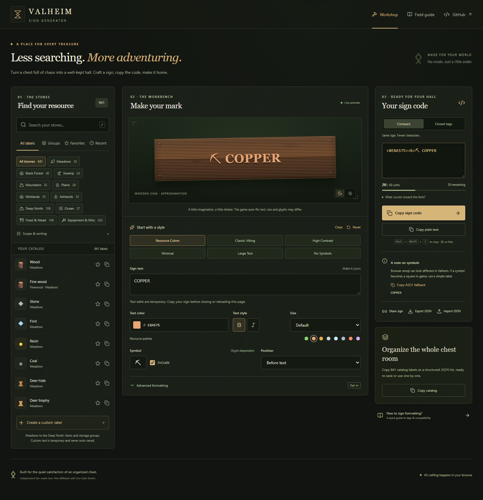

# Valheim Sign Generator

A small workshop for a well-kept great hall. Browse resources, style a wooden sign, and copy compact rich text into vanilla Valheim.

**[Open the workshop](https://valheim-sign-generator.vercel.app)** · [Compatibility evidence](docs/compatibility-research.md) · [Catalog audit](docs/catalog-audit.md)



## Features

- **943 labels:** 893 current inventory items, 48 storage groups, and two preserved legacy labels. All 184 supplied names, symbols, colors, and categories remain unchanged. The default shows 941 labels across progression through the Deep North.
- Eleven biome/category filters, a dedicated Groups view, search by current names, aliases, and group members, alphabetical/progression sorting, favorites, and recent items.
- **Temporary custom labels:** start blank or turn any search into a sign. Draft text, names, and custom symbols are never auto-saved or added to the catalog; reload clears them. Six presets, editable colors, bold/italic, size, symbols, and opt-in alignment/multiple lines remain available.
- Original CSS wooden-sign preview with dark/light timber. No game images, fonts, or other game assets are redistributed.
- Compact or explicitly closed markup, per-entry copy, plain-text copy, ASCII fallback, and complete-category JSON copy.
- Verified **50 UTF-16-unit** input counter, including tags and line-break escapes. Long input is never silently truncated.
- Browser-local formatting preferences and catalog favorites/recents. JSON export and self-contained share links preserve a configuration only when explicitly chosen; opening a shared sign does not overwrite saved formatting.
- Keyboard navigation, `/` to search, Ctrl/Cmd+Shift+C to copy, accessible native dialogs, and a mobile editor/copy bar.
- Clipboard API with a selection-based fallback and a manual-copy dialog if access is denied.

Everything runs in the browser. No backend, accounts, analytics, trackers, cookies, paid APIs, or third-party runtime requests. Shared links include their label text in the URL; share them deliberately.

## Develop

Use Node.js 24 LTS (minimum 22.12) and npm.

```sh
npm ci
npm run dev
```

Vite prints the local URL, normally `http://127.0.0.1:5173`.

```sh
npm run check       # ESLint, TypeScript, unit tests, production build
npm run test:e2e    # Desktop, mobile, tablet browser tests
npm run preview    # Serve the production output locally
```

Local browser tests use installed Microsoft Edge. On another OS, set `CI=1` and install the test browser with `npx playwright install chromium`; the CI workflow uses bundled Chromium. To verify an existing deployment, set `PLAYWRIGHT_BASE_URL` to its origin. No credentials or environment variables are needed by the application.

Runtime dependencies are React, React DOM, and Lucide. Vite, TypeScript, Tailwind CSS, ESLint, Vitest, and Playwright are development tools. `package-lock.json` locks reproducible dependency versions.

## Compatibility with vanilla signs

Research was checked against the installed **Valheim 1.0.17, Steam build 25730771**: sign compatibility on October 12 and the complete inventory census on October 13, 2026. This combines read-only assembly/prefab/font inspection and linked primary sources; it is not an in-game visual acceptance test or a guarantee across platforms.

```text
<#E8A575><b>⛏ COPPER
<#C5D6DE><b>⛏ IRON
<#C9EEFF><b>⛏ SILVER
<#B0B9D3><b>⛏ BLACK METAL
```

Six-digit color shorthand, bold, italic, and numeric size are supported by the installed TextMeshPro renderer. Trailing closing tags are unnecessary for one uniformly styled label. Text colors use the exact supplied RGB values.

The ordinary sign input checks **50 UTF-16 code units**, including markup. JavaScript `.length` matches the game's .NET string counting here; this was verified rather than assumed. `🪵` takes two units, `⛏` one, and joined emoji can take many. UTF-8 bytes and Unicode code points are displayed separately in the length details. Actual editor newlines become literal `\n` in clipboard output, costing two units before the game converts each escape to a line feed. Plain-text copy also uses these game-compatible newline escapes.

The sign auto-sizes between 1 and 8 and starts bold. Web text weight, physical size, colors under game lighting, glyph shaping, and alignment cannot exactly reproduce the game. Background wood, borders, and CSS are never copied. Advanced alignment and multiline output are opt-in because layout can overflow the sign. Arbitrary font selection and asset-dependent TMP tags are not offered.

Of 53 supplied symbols, 46 were present in the inspected bundled font chain. `♛ ♜ ⚿ ✦ ✧ ➤ ⬡` were absent and receive an explicit warning. Font-map presence is not a visual guarantee; browser emoji are not faithful previews of the game's monochrome fallback. Originals remain intact. The ASCII fallback drops the symbol, removes accents where possible, and replaces remaining non-ASCII letters with `?`, visibly previewed before copying.

Raw angle brackets and unsupported control characters are retained in editable text but block regular copy actions. The safe ASCII fallback replaces brackets with parentheses. The app renders text as React text nodes, with no HTML injection or `dangerouslySetInnerHTML`.

See the [full compatibility record](docs/compatibility-research.md) for methods, source links, hashes, font observations, and platform/version limits.

## Catalog maintenance

- `src/data/baseline.json` is the unchanged, supplied three-field dataset. A fixed SHA-256 test protects all original tuples and category counts.
- `src/data/current-items.json` records 893 accepted native item identities and current English names. `inventory.ts` attaches them to preserved labels or adds individual labels; no accepted identity is dropped or duplicated.
- `src/data/catalog.ts` adds typed metadata and aliases. Original names remain the default labels and searchable display names. `groups.ts` supplies authored storage groups and member searches.
- Corrections such as Oak seeds → Acorns and Bear pelt → Bear hide appear as aliases. Yagluth thing is retained as legacy, and Ooze trophy is retained with an unverified note.
- Current items, including special/progression items, are visible by default. Legacy originals are opt-in; five seasonal or entitlement items have condition notes. Generic storage groups carry a group badge.
- [The audit](docs/catalog-audit.md) and [complete census](docs/inventory-census.json) account for all 1,519 native item prefabs: 893 accepted, 615 excluded, and 11 unresolved. This is a configured-acquisition audit, not a playthrough of every route. NPC attacks, character customization, inactive duplicates, and unused objects are not ordinary inventory labels.
- Preferences use a versioned whitelist containing only formatting, wood, and catalog IDs. Loading old version 1 preferences removes their stored draft content before migration. Custom input never enters favorites, recent items, local storage, or session storage. Explicit export/share remains the user's choice.

## Deploy to Vercel

Import the public GitHub repository into Vercel and use:

| Setting | Value |
| --- | --- |
| Framework | Vite |
| Production branch | `main` |
| Install command | `npm ci` |
| Build command | `npm run build` |
| Output directory | `dist` |
| Node.js | 24.x |

No backend, secrets, database, custom domain, or `vercel.json` is necessary. Vercel's native GitHub integration builds pushes to `main` for production and other branches for preview. GitHub Actions independently runs lint, types, unit tests, build, and browser tests. This repository does not claim that CI checks gate Vercel promotion; that would require separate Vercel deployment-check configuration.

Never commit `.vercel`, `.env` files, tokens, or browser state. They are excluded by `.gitignore`.

## License and attribution

The source is available under the [MIT License](LICENSE). This is an independent fan-made tool and is **not affiliated with or endorsed by Iron Gate Studio or Coffee Stain Publishing**. Valheim and its names belong to their respective owners. All decorative sign and interface artwork here is original CSS/SVG; no copyrighted game UI assets are copied.
